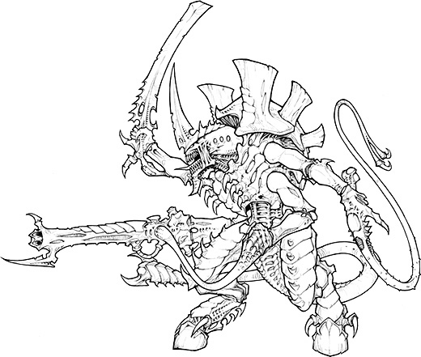
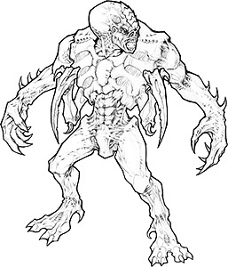
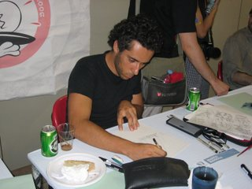

# 泰伦虫族概念设计师罗伯托．西瑞罗

【原翻】【响应基要主义计划号召】泰伦虫族概念设计师罗伯托．西瑞罗

eliphasfan

罗伯托．西瑞罗是宝典：泰伦虫族的主导概念艺术家。罗伯托是新加入ＧＷ设计工作室，您可能没有听过太多关于他，但他对宝典：泰伦虫族的工作确实是一个令人印象深刻的介绍。 

罗伯托于2004年加入ＧＷ，并带来了丰富的商业设计经验；他为电脑游戏业提供二维及三维设计已近13年。 在真正的设计工作室作风下，罗伯托在走进了大门时就被扔到了深底，困在他的房间里开始了关于泰伦虫族的工作。许多在更广泛的行业工作的艺术家可能在完全符合战锤世界的非常具体和精细图象时遭遇麻烦，但罗伯托直接进入了状态。 “我一直都带着兴趣和激动关注着新的战锤４０，０００微缩模型”，罗伯托解释道。 罗伯托的第一项任务是与杰斯．古德温就新暴君的设计并肩工作。 “它始于杰斯告诉我他的一些原创设计和想法，我们讨论了什么是必须保持的和哪些要素是值得探讨和扩大的”，罗伯托解释道。正是这扩大一个已经是良好的实现了设计的要素使罗伯托热情高涨；“我就是爱的所有武器和生物器件――他们顺利地融入到其它生物中的方式，这一切造就了一个巨大残酷的异形！”罗伯托和杰斯花了一些时间，精炼了主脑的相应技术。“没有螺栓，齿轮或任何类型的无机化合物”罗伯托解释说，“这是纯粹的，自我持续的天才进化。”

另一个罗伯托创作的概念是巢主（Ｂｒｏｏｄｌｏｒｄ）。“我得到了比较开放的自由”，罗伯托说“但非常重要的是，新的设计必须保持种族的外观和感觉，他们得要符合他们现有的范围。”

不仅是同杰斯，罗伯托也密切配合菲尔（好几部宝典的作者……）对许多概念设计过程的细节进行工作。“重要的是，我不能提出在游戏根本是行不通的想法，但在同一时间内，我需要维持带来酷而新设计的自由”。菲尔和罗伯托作为一个团队显然行之有效，我敢肯定，大家看到新的微缩模型都会明白他们所做的前期工作。 

------------------------------------------------我是勤劳的分割线----------------------------------------------------

嗯ｕｎ０７，我搞定鸟，图在这里，[点击进入传送门](http://zhihuiguan.com/bbs/read.php?tid=25949&fpage=2)

他的个人主页在这里，[点击进入传送门](http://homepage.ntlworld.com/r.cirillo/index.html)

更新玉照一张
