# 泰伦虫族特殊“人物”

【原创翻译】【申精】泰伦虫族特殊“人物”

eliphasfan

[死亡跳跃者](http://uk.games-workshop.com/tyranids/special-characters/4/)

新的死亡跳跃者模型使用泰伦虫族宝典中标准幽灵虫的规则。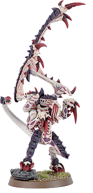

这里的规则是ＧＷ加拿大为其线上战役，[虫潮崛起](http://ca.games-workshop.com/rise_of_swarm/home.htm)，所设定。虽然战役已经结束，当我们仍将其背景规则与红色恐怖和老独眼放在一起。此特殊规则并非正式，你需要对手的同意去使用它。 

＋＋计入：连队记录２４７６５６ 输入：中士伊拉斯姆思兄弟 巡逻地区：德朗二：：布拉沃二分区 传往：突击巡洋舰不摧意志 每日一思：惧生异端＋＋ 

个人记录：日７－１６：４３：０３.２２时 

发现信号。我追踪它到了三号检查站却在距山脊两公里处失去信号。与其他的幽灵虫相比，我注意到这个有些缓慢。有可能是因为带伤，或只是比平常小心。 

慈是为弱 

个人记录：日７－２２：０３：３１.３４时 

我们在３２７终点站调查近期的敌对活动。所有的生物信号都是红的。到现在我们已经找到了十二具尸体的部分了。多姆斯兄弟认为可能有幸存者藏在了主热能交换器中。 

无辜未可证无罪

个人记录：日７－２２：２４：５６.３１时 主热能交换器看起来像是被一个切割机冲进去了似的，这绝对是泰伦虫的痕迹。多姆斯兄弟说得对，这里确实有个幸存者，只是因为过度惊吓而说不出话来。法提斯兄弟将会执行帝皇的宽恕。我收到了一个微弱的残留生物信号，显示那畜牲上个小时还在这里。我们将立即离开３２７终点站前往追击。 

一无所有者仍能奉献生命

个人记录：日７－２３：３０：５４.０１时 

死亡跳跃者跟踪了我们六个小时――它的信号在我的探测器上出现了至少十二次。我的小队以帝皇之名用净化爆弹与正义之炎占据了目标区域――却还是效果不明。我们应在六分三十二秒内接应阿尔缇侦查小队，可这十分钟里我们一直无法用对讲器建立联络。我们即将前往集合地点并顺路调查北两百米处副燃料站的一个微弱的信号。 

烈士之血是为帝国之种

－－－－－－－－－－－－－－－－－－－－－－－－－－－极限战士战团，伊拉斯姆思中士的记录 

死亡跳跃者是一个精锐选择，可与其他幽灵虫一起加入任何泰伦虫族部队 

死亡跳跃者 WSBSSTW IALdSv

９０点 6-64263+11０6+

生物武器：与其他的幽灵虫一样，死亡跳跃者具有一对镰刃爪和一对撕裂爪，并具有供给蔓须和肉钩。死亡跳跃者不能具有其它变异。 

死亡跳跃者除以下不同之外使用普通幽灵虫规则正如泰伦宝典所述。 

无双诡秘：死亡跳跃者像正常幽灵虫那样部署，但并不需要处于地形之中――它可以出现在任何地方。 

激怒：死亡跳跃者是一个极其凶残的幽灵虫，它额外多有一次攻击（已含）。但是因为它在与伊拉斯姆思中士的战斗中负伤，它的护甲只有６＋ 

幽灵虫――利卡特的一般规则――战锤中文网 人类命名：Lictor 常用称呼：Spook, Mantis Stalker

生物命名：Tyranicus Chameleo

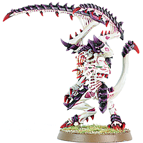

单位规模： 

1-3只可以组成一个精锐单位，但是一支军队中仅能配置一窝利卡特（最多3只）。利卡特在部署时不需要放在一起，游戏中也可以分散行动。 

生物兵器与生体形态： 

利卡特长有镰刀巨爪和撕裂之爪，并且总是具有摄食触须和棘刺肉钩。 

特殊规则： 

秘密部署（Secret Deployment）： 

利卡特永远使用深入打击（Deep Strike请参阅规则书）上场，不管是在什么任务中，用来表现它们总是神出鬼没的跳出来。使用深入打击的时候，它们必须部署在区域地形里面，即便投掷骰子决定部署地点时，不当心投入了不可通过地形，它也不会被消灭，依然可以部署（逆天的强！）；如果投掷骰子决定部署地点时，不当心偏出了区域地形，那么它可以部署在区域地形里面，最靠近指示地点的那条边缘，但是底盘不可以离开区域地形。利卡特进入游戏的那回合便能攻击。 

独立（Loner）： 在那些要求完成任务的游戏中，利卡特不能拿来占领阵地，夺取战利品，总之不算作得分单位。 

隐匿（Stealth）： 利卡特具有变色龙一般的鳞片，这使它极难被发现并攻击。不管在什么地方，哪怕空地上，它也有起码5+的掩体保护。另外在掩体里时，保护色让它的掩体保护再+2（最高可以到2+！）。例如在树林或者丛林中时，利卡特将会有3+掩体保护。不过在近战时利卡特无法得到隐匿的好处，仅能依靠硬质甲壳提供的5+护甲保护。 

无畏（Fearless）： 在虫族群体意识的驱动下，利卡特根本不知畏惧为何物。无畏的详细规则请翻阅规则书第74页。 

信息素追踪（Pheromone trail）： 

利卡特会沿路留下信息素，附近的虫族生物都会寻踪而至。在游戏中，虫族军队里有多少只利卡特（不管部署了没有），虫族玩家每回合就可以重掷多少次骰子，投入预备队。但是当利卡特自己在预备队里时，并不适用此重掷。 

打了就跑（Hit and Run）： 利卡特想战便战，想跑就跑。可以选择主动离开近战，详细规则请翻阅规则书第74页。 

[老独眼](http://uk.games-workshop.com/tyranids/special-characters/3/) 一个１５００点及以下的泰伦虫潮（是的，就是以下）可以包括一只老独眼。它被算作重型支援选择。 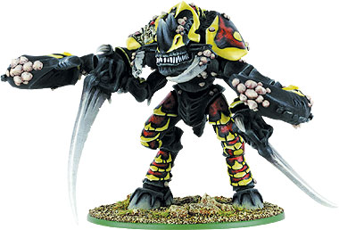

这家伙一定被埋在冰上百年了，也许从虫巢舰队比蒙冲击马卡各时起，说不定更长。这家伙极其丑恶，明显的死了。一位帝国英雄想来在被撕成碎片前把等离子手枪插进了它的眼睛里，那儿现在足有我脑袋那么大的一个烧焦了的弹坑。我们把它从冰里化出来，挂在了拖拉机上，在坎尼斯那边机械教的人要泰伦虫的标本，我们觉着这家伙能换个大赏钱。走到一半拖拉机就开始摇晃扭曲，后面传来惨叫声。我不是什么星际战士，贾克斯和喀哲也不是，况且我也不傻。我们跳下车就开始跑，可那家伙也很快，最后只有我逃回来了。 

－－－－－－－－－－－－－－－－－－－－－－－－－－艾瑞尔．胡斯特――考古海盗的最后证言 

老独眼是一只在奥塔玛区域喀什的冰盖中发现的一只行刑虫变体。从解冻以来它领导了一系列的泰伦突袭，传说它将主脑的意识召回到了奥塔玛星域。老独眼的结局是个谜，但在其它行星上也发现了落单负伤的却又一样致命的行刑虫。 

老独眼 WS BS S T W I A Ld Sv １９９点 4 2 10  6    4 2 D6+1  10 2+ 

生物武器：老独眼有一对镰刃爪和一对变异了的巨型粉碎爪。老独眼不能具有不同的武器。 变异：肾上腺（＋１ｗｓ）肾上腺（＋１Ｉ）毒液腺（＋１Ｓ）扩充甲壳（＋１ｓｖ）（已含） 

泰伦怪兽：老独眼是一只泰伦怪兽，正如ＷＨ４０Ｋ规则书中第５５页所述。 

巨型粉碎爪：老独眼有一对巨大的蟹爪，能将最坚固的敌人撕成碎片。这表现为老独眼有Ｄ６次近战攻击，因为镰刃爪再加一变为Ｄ６＋１（冲锋时为Ｄ６＋２）。 

（毛．．．这跟普通的粉碎爪有什么区别．．．囧ＴＺ） 

 

再生：老独眼数次表现出能够复原伤口的恼人能力。有理论认为它是一个被主脑抛弃了的变异或是一个快速细胞再生的实验。在每一个泰伦虫族的回合结束时，老独眼回复一个创伤（最多到４）。如果老独眼被杀死，那么在死处做标记，在下一个泰伦虫族的回合结束时掷Ｄ６。结果在４及以上是老独眼原地重生（仅有一伤），若３英寸内有敌人这自动进入近战。结果为一至三时老独眼彻底死亡。

补图 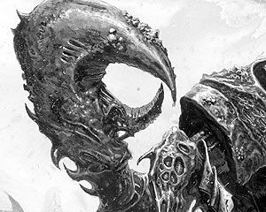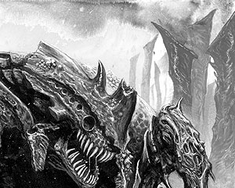

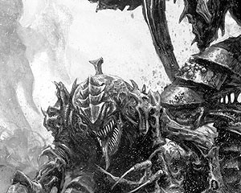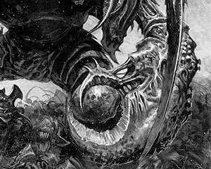

Orz the pic come in four pieces.... those GW stuffs are ***brain-missing..

.......................... these people must be infested by chaos...One picture in four pieces? just ridiculous

 the red terror

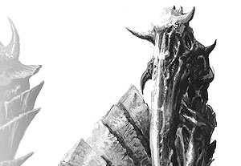

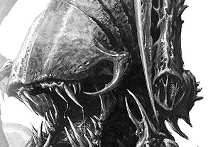

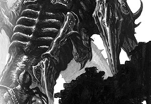

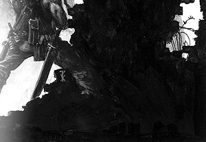

<h4>红色恐怖</h4>

存位置。。。。。。。。红色恐怖即将到来&lt;=已经<strike>到来</strike>

 完成 －－－还有故事没翻完，大家等等吧…… ＋＋未完待续（北京时间１６：０７） 北京时间１７：１６完成 

一个至少１５００点的泰伦虫潮可以包括[红色恐怖](http://uk.games-workshop.com/tyranids/special-characters/2/)。它将单独记作一个快速攻击选择。 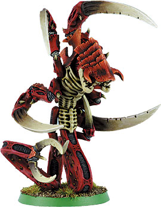

帝皇知道从什么鬼地方爬出了这只丑恶的幽灵，我们管它叫红色恐怖。它最初攻击了外部堡垒，在我们用喷火器把它赶走前它杀死了２４个士兵。我们再也没找到波拉尔斯中尉和娄恩上尉的尸体，剩下的就只是一条从指挥中心直到隧道的酸性黏液。它在第二天夜里回来，又开始了屠杀，但这回我们做好了准备――至少我们是这样想得……

－－－－－－－－－－－－－－－－－－－－－－－－摘录：地狱中的二十天――迪瓦兰一星大撤退 

红色恐怖是在迪瓦兰，一个帝国东线的采矿世界上的袭击中见到的一只泰伦虫族。虽然再也没有相关报告，但这极有可能在其它与此生物或其近似的遭遇中没有幸存者。 

红色恐怖 WS  BS  S  T  W  I  A    Ld  Sv １０４点      6      -    5  5  3    3 3+2 10  3+ 生物武器：红色恐怖具有两对镰刃爪（额外攻击已计入）。红色恐怖不能有任何变异或不同武器。 

深入打击：红色恐怖从地下穿入服务隧道一路冲进迪瓦兰的星际站，没路时它就挖出一条来。红色恐怖可以用深入打击进行部署，但只能在任务认许时方可适用；若任务不准则正常部署。 

(这跟普通的又有什么区别……脑残 ) 

迅捷：红色恐怖可以移动９英寸，还可以突击９英寸；当经过困难地形时可以在最高值上＋３。红色恐怖撤退和追击３Ｄ６英寸。 

泰伦怪兽：红色恐怖是一只泰伦怪兽，正如ＷＨ４０Ｋ规则书中第５５页所述。 

囫囵吞：红色恐怖可以将整个人像不幸的波拉尔斯中尉和娄恩上尉那样生吞。如果红色恐怖在近战攻击时掷出４或以上，它可以将一个底盘接触的敌人整个吞下！（这并不需要事先声明，这是你在适合情况下的选择）。如此一来红色恐怖不能继续攻击，因为它全神贯注地忙着吞下不幸的受害者。被吞者直接算作死亡，不计创伤，护甲或免伤豁免，义肢等装备均作无效。 

如下模型不受影响： 力量或坚韧过五的（包括附加值，如纳垢印记等） 摩托或骑兵 具有装甲值的（无畏，石化蜥蜴等） 

这被黏液覆盖着的隧道伸向远方，暴风突击队的卤素灯在墙上闪耀。那东西为了猎食从泥土岩床与钢筋水泥中直挖出了一条道，废墟一层层的贴在墙边。刺鼻的恶臭简直不可容忍，狭窄的环境也让暴风突击队寸步难行。他们在这滴水的隧道中待了整整六个小时，凯弗拉装甲都已开始被酸性黏液腐蚀。 

科瑞甘中士一听到消息就自愿领导这次的搜寻――摧毁任务。他的两个士兵在食堂被杀，破碎的躯体摔落在桌子上，鲜血混杂着撒出的食物。一开始他的请求因为过于激动而未被批准。可在那东西又杀了十八个士兵后，他就是唯一的一个对此有任何经验的队长了。它必需被尽快停止。 

他计划着在那家伙吃过后跟踪它回它的巢穴，趁它在消化最后一餐是杀了它。早些时候其林被它吃了；假如他不尽快行动的话，它就会再度猎食。 科瑞甘看了下喷火器的计量表；先前被撕裂虫吓到时他们浪费了一些珍贵的燃料。他目镜里的温度计表明这几乎是黄昏时分；他们快没时间了。 探测器上的信号以令人担忧的速度向他们接近，毫无疑问那东西闻到他们了。科瑞甘只觉得他们不再是猎人了。 “列队，就是这个。我们找到它了。罕，冯．都，进入位置．” “帝皇啊！它在那儿！十二点钟方向，快速接近中！” 梦魇一般翻腾着的利爪和甲壳顺着隧道朝他们冲来，外壳上覆满了鲜血和黏液。领头的暴风突击队向通道中喷出了高热化学物质的焚云，烈焰的痛风涌下通道――只听得一声震耳欲聋的尖叫。当回炎的温度开始令人难忍时，科瑞甘下令停火。 

隧道是空的。刺鼻的恶臭现在更加糟糕――他们的面具正超时工作以过滤空气。墙壁现在被烧焦的黏液染黑。科瑞甘看了看探测器，可上面之有他的小队。 冯．都问道：“萨奇？它在哪儿？”科瑞甘一言不发，他不能承认他也不知道。过了好一会儿，小队又继续前进了，他们的阴影笼罩了前方的隧道。 通道进入了一个充满了嘶嘶作响的管道和轰鸣引擎的矿用地下发电室。在小队分散搜索时他们的金属鞋底在栅栏地上铿锵发声。 观察着四周，科瑞甘未能及时注意到探测器的鸣叫――屏幕中又多了一个信号！ 那东西随着金属撕裂的尖叫从步道下面冲出，像个简陋的蛹一般展开时将前爪钻入了罕的胸膛，挖出了一大块血肉。它以蛇一样的速度用碳酸钙的巨爪抓住了冯．都，在所有人没反应过来时就消失在了洞里。冯．都的尖叫被咳嗽截断。 

“快追！”科瑞甘大喊，他冲向前方，喷火器朝步道上的洞中吐出了火枪。借着什么东西着火的亮光他看见蜿蜒的肌肉和利爪在栅栏下蛇行，他的小队紧跟着他在这异形后面狂奔。 

一分钟之后，科瑞甘承认了他们失去了冯．都的事实，也注意到了他们根本就不知道自己在哪。 转过墙角，他看到了令他恶心到几近不能行动的画面。那东西伸展着躺在黑暗的角落里，它充满唾液的骨质下巴扩张的几不可能的宽，甲壳随着蠕动翻起涟漪。冯．都那被黏液覆盖的头从嘴中伸出，空开的双眼在被彻底吞下前直直地盯着科瑞甘。 

一声怒吼，科瑞甘和他的队员开火了，毁灭一切的烈焰照出了它的轮廓。它在炼狱中翻腾了一下就消失了。暴风突击队焦虑地向前突进――只一会儿功夫―― 那东西从管道后面爬出，大张着嘴猛撞向他们。在他们能开火前就已经冲到了他们中间，一只爪子扎入了奈弗的后背，在它的螯尾切入韦德脖子的同时将他钉在了栅栏上。 

随着向前猛冲的势头它的副肢横扫；一只爪子穿过空气划向皮特卢维奇的脑袋。他闪过了这一击，利爪扫过他的头盔，把他砸进了管道里。它从韦德脖子那猛扭过尾巴，缠住了皮特卢维奇的腿就把他往嘴里拽。可突击队员的护甲嵌进了管道之间，阻止了拖曳。那时候皮特卢维奇悬在地板上疯狂尖叫；随后他的身体在血爆中被从腰撕成两半。 

科瑞甘带着滋滋作响的链锯剑从向了它分节的身体；这一击砍进了一只巨爪，链齿轰鸣着切入骨中；他的手被推开，链锯剑拧出了他的手掌。那东西转过来，它的嘴大张；科瑞甘未曾来得及叫喊就被吞下。 

科瑞甘在剧痛中醒来，他的视野红黑，他的身体被燃烧着的痛苦折磨；他被困在那东西的消化腺里了。他护甲上的生命维持已经超载，肾上腺素震动着他的身体。他大致感到运动，可是肌肉却软弱麻木；催眠的消化液在慢慢地蚀去暴露的血肉。 

外界的运动停止了，它开始抽搐，强健的肌肉将他向前推入光中。科瑞甘最后看到的是冯．都的残余跟着他滑出――红色恐怖将它的最后一餐吐回了消化池的强酸中。
